<div align="center">



<a href="https://shlok-portfolio.pages.dev/">Portfolio</a> &nbsp;·&nbsp; <a href="mailto:shlokparekh08@gmail.com">Email</a> &nbsp;·&nbsp; <a href="https://github.com/Shlok-Parekh09?tab=repositories">Repositories</a>

<br/>


<a href="https://github.com/Shlok-Parekh09?tab=repositories"></a>

<sub>Rebuilt from my avatar on every run. The numbers beside it come straight from the GitHub API.</sub>




<sub>Three live gauges: how consistent I am, when in the day I ship, and how this quarter compares to the last.</sub>


<a href="https://github.com/Shlok-Parekh09#js-contribution-activity"></a>

<sub>One building per day. Height is contributions, lit windows mean activity, the beacon marks my busiest day.</sub>


<a href="https://github.com/Shlok-Parekh09?tab=repositories&sort=updated"></a>

<sub>Every repo is a neuron, wired to the ones it shares topics, a name family or a language with. Rings mark what I pushed recently.</sub>

</div>

<div align="center">


<a href="https://github.com/Shlok-Parekh09/Shlok-Parekh09/issues/new?template=star.yml"></a>

<sub>One star per day for the last year; the core is today.<br/><b><a href="https://github.com/Shlok-Parekh09/Shlok-Parekh09/issues/new?template=star.yml">Add your own star</a></b>: pick a colour and your handle orbits here too.</sub>




<sub>My last two weeks of pushes, one lane per repo. Taller bar, busier window. The table below has the details.</sub>

</div>

<!--OPS_START-->
| Repo | Stack | Last push | Brief |
|:--|:--|:--|:--|
| [**AI_Deepfake_Detector**](https://github.com/Shlok-Parekh09/AI_Deepfake_Detector) · [live](https://ai-deepfake-detector-three.vercel.app) | `Python` | today | A multimodal deepfake detection engine evaluating video, audio, and static image authenticity… |
| [**cipher-rakshak**](https://github.com/Shlok-Parekh09/cipher-rakshak) · [live](https://main.d3pgmkd8eujd0c.amplifyapp.com/) | `TypeScript` | 2d ago | _Still cooking._ |
| [**course-verifier**](https://github.com/Shlok-Parekh09/course-verifier) | `Python` | 10d ago | The Autonomous Course Verifier is a Python-based tool that extracts educational data from… |
| [**AI_based_CRM**](https://github.com/Shlok-Parekh09/AI_based_CRM) · [live](https://custbuds.web.app/) | `TypeScript` | 11d ago | _Still cooking._ |
| [**CodeGuard**](https://github.com/Shlok-Parekh09/CodeGuard) | `Python` | 11d ago | CodeGuard is an advanced defensive security agent dedicated to safeguarding your software… |
| [**Real-Time-Anomaly_Detection**](https://github.com/Shlok-Parekh09/Real-Time-Anomaly_Detection) · [live](https://real-time-anomaly-detection-omega.vercel.app) | `Python` | 32d ago | Anobis: Offline, local-first document fraud detection and KYC forensic investigation platform… |
| [**shlok-portfolio**](https://github.com/Shlok-Parekh09/shlok-portfolio) · [live](https://shlok-portfolio.pages.dev/) | `JavaScript` | 35d ago | _Still cooking._ |
| [**intrusion_detection**](https://github.com/Shlok-Parekh09/intrusion_detection) · [live](https://intrusion-detection-three.vercel.app) | `TypeScript` | 4mo ago | _Still cooking._ |
<!--OPS_END-->

<br/>

<div align="center">


**A three-stage CTF is hidden in this profile.** Crack it and you join the Hall of Fame below, automatically.

</div>

```text
STAGE 1 / 3   (base64)
U1RBR0UgMS8zIDo6IG5pY2UsIHlvdSBkZWNvZGVkIGJhc2U2NC4gdGhlIHJlcG8gbWFwIGlzIG1vcmUgdGhhbiBhIHBpY3R1cmU6IG9wZW4gYXNzZXRzL25ldXJhbC5zdmcgYXMgcmF3IHRleHQgYW5kIHJlYWQgaXRzIDxkZXNjPiBlbGVtZW50LiBpdCBpcyBoZXgu
```

<details>
<summary><b>Rules and how to submit</b></summary>

<br/>

- Each stage leads to the next. The final answer is a flag shaped like `SHLOK{...}`.
- **Don't post the flag.** Issues are public. Submit a *proof* bound to your login instead:
  ```bash
  echo -n "SHLOK{the_flag_you_found}:your-github-login" | sha256sum | cut -c1-12
  ```
  (login in lowercase, 12 hex characters out.) A leaked proof is useless to anyone else.
- [**Submit your proof**](https://github.com/Shlok-Parekh09/Shlok-Parekh09/issues/new?template=ctf.yml). An Action checks it and, if it's right, adds you below within a minute.
- No brute force needed. Everything you need is in this repo and the names of my AI repositories.

</details>

<div align="center">

**Hall of Fame**

</div>

<!--HOF_START-->
| # | operator | cracked on |
|:-:|:--|:--|
| 🥇 | [@Shlok-Parekh09](https://github.com/Shlok-Parekh09) | 2026-10-20 |
<!--HOF_END-->

<br/>

<div align="center">


<br/><br/>


<br/><br/>

